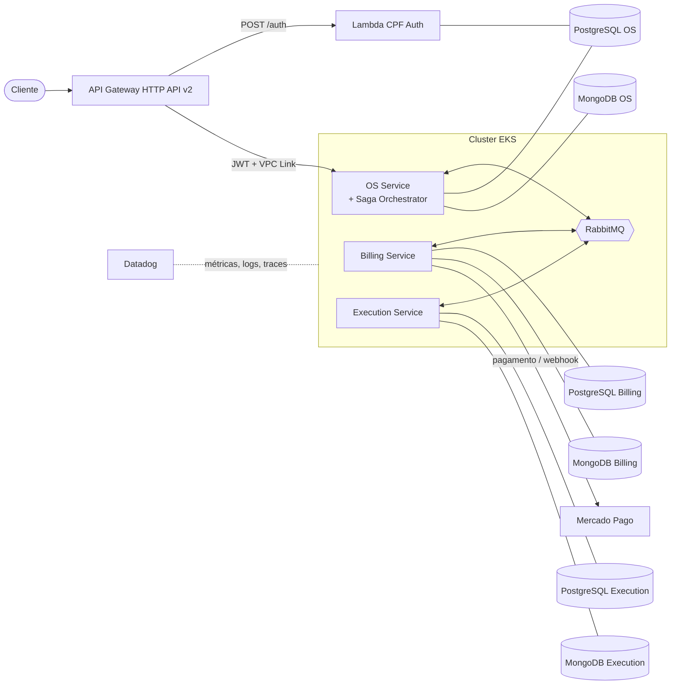
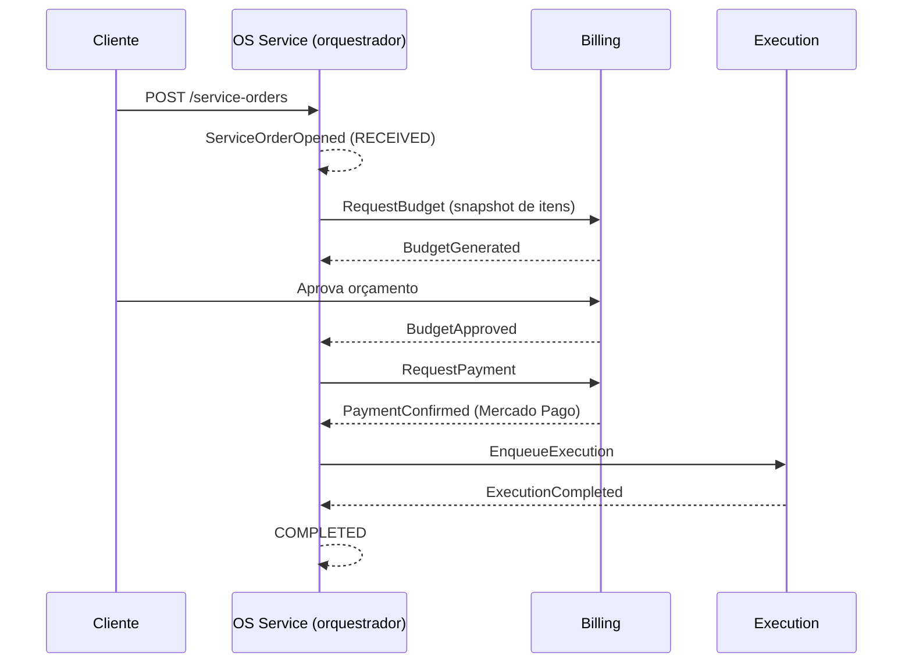
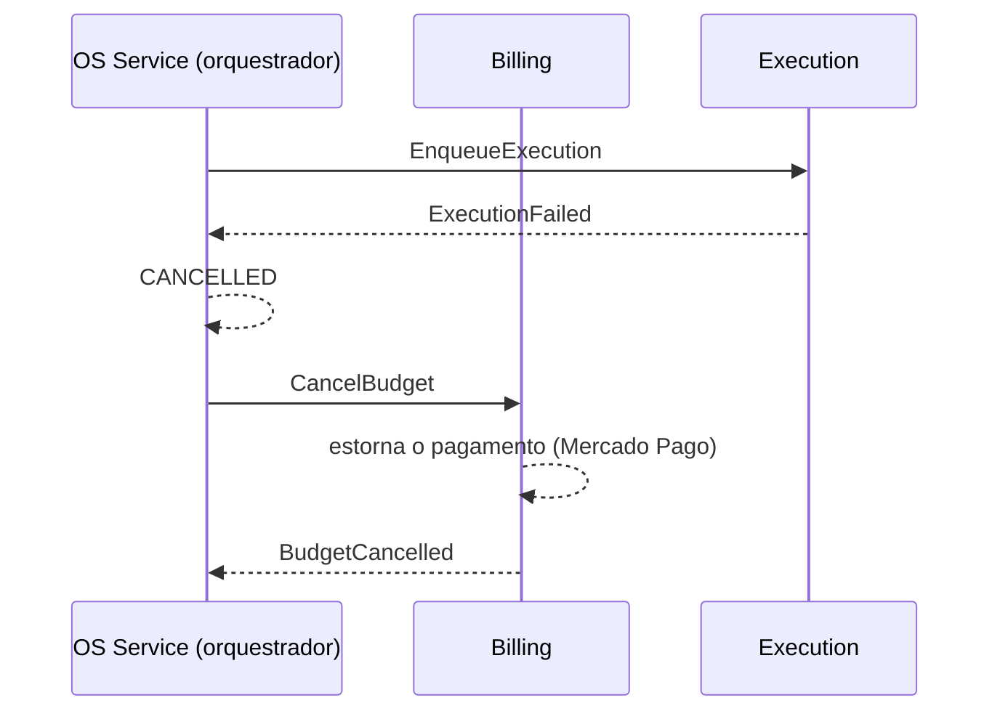

# Arquitetura — Fase 4 (Microsserviços + Saga)

## Visão geral

Nenhum serviço acessa o banco de outro; a comunicação é por mensagens (RabbitMQ) e, quando necessário, REST.

## Saga — fluxo feliz

## Saga — falha na execução (compensação)

## Estados da OS e da Saga

`RECEIVED → IN_DIAGNOSIS → AWAITING_APPROVAL → AWAITING_PAYMENT → IN_EXECUTION → COMPLETED → DELIVERED`, com `CANCELLED` alcançável por rejeição ou compensação. `AWAITING_PAYMENT` é novo na Fase 4.

## Catálogo de eventos e comandos

| Nome | Tipo | Produtor → Consumidor |
|---|---|---|
| `ServiceOrderOpened` | evento | OS → (saga) |
| `RequestBudget` | comando | OS → Billing |
| `BudgetGenerated` / `BudgetFailed` | evento | Billing → OS |
| `BudgetApproved` / `BudgetRejected` | evento | Billing → OS |
| `RequestPayment` | comando | OS → Billing |
| `PaymentConfirmed` / `PaymentFailed` | evento | Billing → OS |
| `EnqueueExecution` | comando | OS → Execution |
| `ExecutionCompleted` / `ExecutionFailed` | evento | Execution → OS |
| `CancelBudget` | comando (compensação) | OS → Billing; cancela o QR ou estorna o pagamento, conforme o estado do pagamento |
| `BudgetCancelled` | evento | Billing → OS |
| `CancelExecution` | comando (compensação) | OS → Execution |

Todas as mensagens carregam `ServiceOrderId` (correlação), `MessageId` (idempotência) e o *trace context* para rastreamento distribuído no Datadog.

## Decisões relacionadas

ADR-010 (divisão), ADR-011 (saga + mensageria), ADR-012 (bancos), ADR-007 (API Gateway), ADR-009 (HPA).

### Payloads

Cada serviço publica seus contratos no namespace `TorqueOS.Contracts.<Serviço>`: os do OS Service ficam no projeto `MechanicsSoftware.Contracts` (namespace `TorqueOS.Contracts.ServiceOrders`) e os do Billing em `TorqueOS.Contracts.Billing`. Quem consome deve usar **o mesmo namespace e nome de tipo** de quem publica, pois o MassTransit identifica a mensagem por eles (`urn:message:<namespace>:<tipo>`).

| Mensagem | Campos |
|---|---|
| `ServiceOrderOpened` | `ServiceOrderId` (Guid), `CustomerId` (Guid), `VehicleId` (Guid), `OpenedAt` (DateTime, UTC) |
| `EnqueueExecution` (`TorqueOS.Contracts.Execution`) | `ServiceOrderId` (Guid), `Priority` (int, padrão 0) |
| `CancelBudget` (`TorqueOS.Contracts.Billing`) | `ServiceOrderId` (Guid) |

