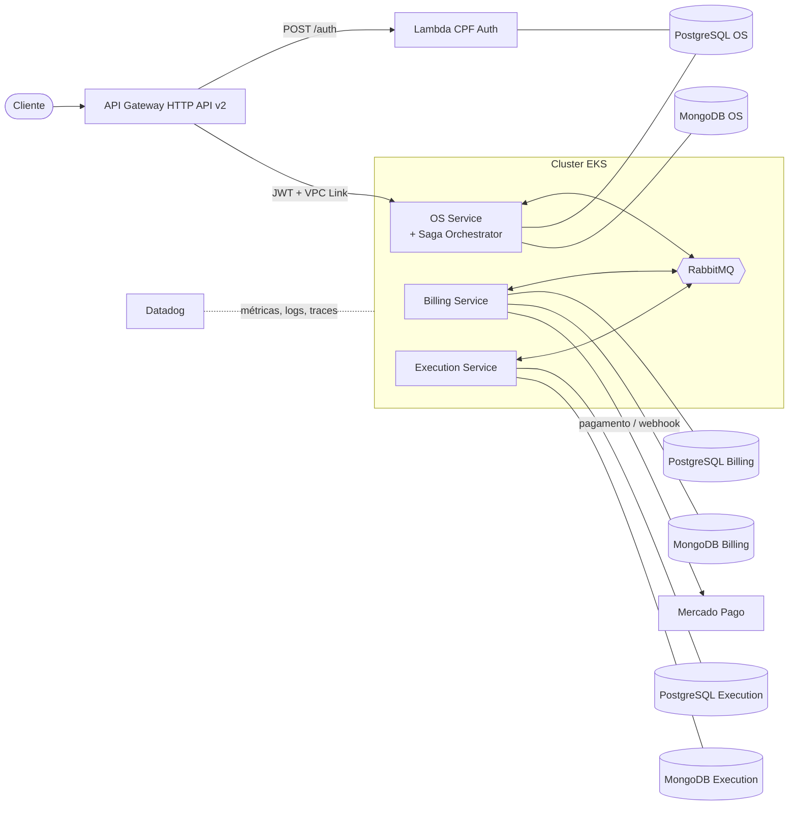
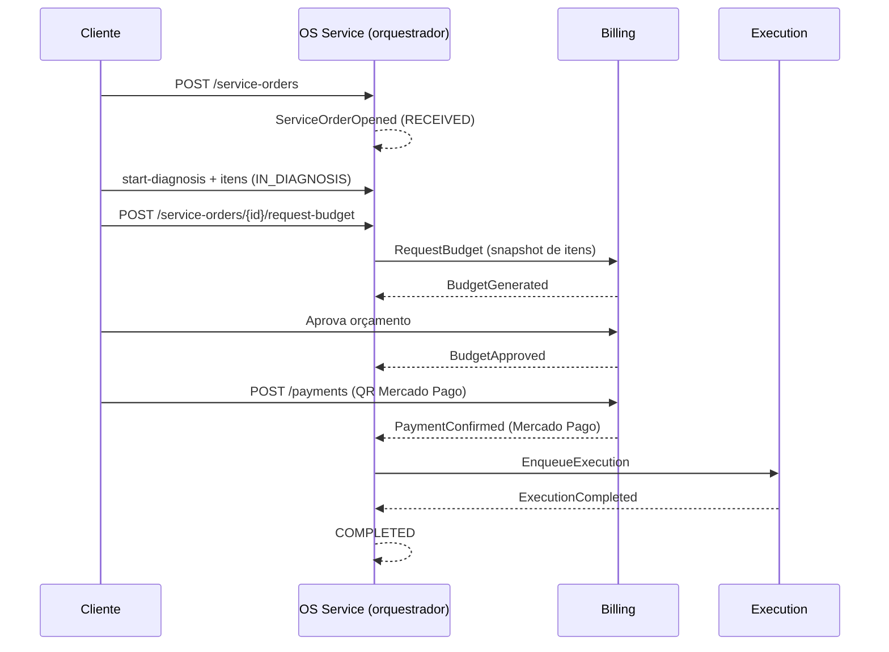
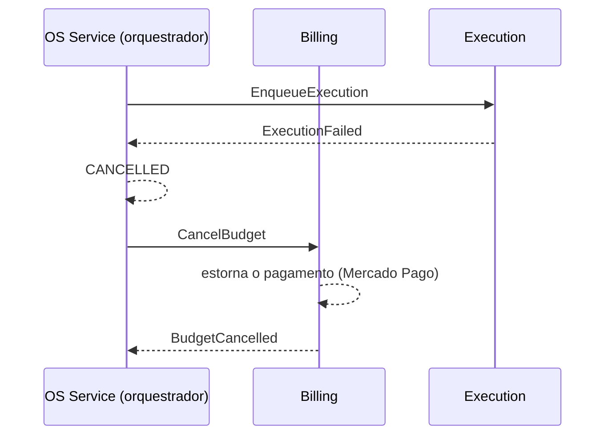

# Arquitetura — Fase 4 (Microsserviços + Saga)

## Visão geral



Nenhum serviço acessa o banco de outro; a comunicação é por mensagens (RabbitMQ) e, quando necessário, REST.

## Saga — fluxo feliz



## Saga — falha na execução (compensação)



## Estados da OS e da Saga

`RECEIVED → IN_DIAGNOSIS → AWAITING_APPROVAL → AWAITING_PAYMENT → IN_EXECUTION → COMPLETED → DELIVERED`, com `CANCELLED` alcançável por rejeição ou compensação. `AWAITING_PAYMENT` é novo na Fase 4.

## Catálogo de eventos e comandos

| Nome | Tipo | Produtor → Consumidor |
|---|---|---|
| `ServiceOrderOpened` | evento | OS → (saga) |
| `RequestBudget` | comando | OS → Billing |
| `BudgetGenerated` / `BudgetFailed` | evento | Billing → OS |
| `BudgetApproved` / `BudgetRejected` | evento | Billing → OS |
| `PaymentConfirmed` / `PaymentFailed` | evento | Billing → OS |
| `EnqueueExecution` | comando | OS → Execution |
| `ExecutionCompleted` / `ExecutionFailed` | evento | Execution → OS |
| `CancelBudget` | comando (compensação) | OS → Billing; cancela o QR ou estorna o pagamento, conforme o estado do pagamento |
| `BudgetCancelled` | evento | Billing → OS |
| `CancelExecution` | comando (compensação) | OS → Execution; consumido pelo Execution, ainda não enviado pelo OS (as compensações atuais acontecem antes de enfileirar ou depois de a execução falhar) |

O pagamento é iniciado pelo cliente no Billing (`POST /api/payments`), por isso não existe um comando `RequestPayment`.

Todas as mensagens carregam `ServiceOrderId` (correlação), `MessageId` (idempotência) e o *trace context* para rastreamento distribuído no Datadog.

## Confiabilidade da mensageria (F4-24)

Nos três serviços, todo consumidor tem:

- **Inbox** — uma mensagem com `MessageId` já consumido é descartada (`inbox_state`).
- **Outbox** — comandos e eventos são gravados na mesma transação da mudança de estado e enviados depois do commit.
- **Retry** — 5 novas tentativas com backoff exponencial (cerca de 16 s) para falhas transitórias; regra de negócio violada ou entidade inexistente vai direto para a fila `_error` (DLQ), sem novas tentativas.
- **Handlers idempotentes** — um evento cujo efeito já foi aplicado não altera nada nem reenvia comandos.

## Consulta síncrona (F4-25)

```mermaid
sequenceDiagram
    participant C as Cliente (staff)
    participant OS as OS Service
    participant B as Billing
    C->>OS: GET /service-orders/{id}/billing
    OS->>B: GET /budgets?serviceOrderId= (token repassado)
    B-->>OS: orçamento (ou 404)
    OS->>B: GET /payments?budgetId=
    B-->>OS: pagamento (ou 404)
    OS-->>C: orçamento + pagamento
    Note over OS,B: timeout 2 s/5 s, retry com backoff, circuit breaker;<br/>Billing fora do ar → 200 com billingAvailable=false
```

Regras na [ADR-013](../decisions/ADR-013-rest-sincrono-entre-servicos.md).

## Observabilidade da saga (F4-37)

Dashboard Datadog com volume de OS, tempo por etapa, compensações, fluxo de mensagens e DLQ: [docs/observability/saga-dashboard.md](../observability/saga-dashboard.md).

## Decisões relacionadas

ADR-010 (divisão), ADR-011 (saga + mensageria), ADR-012 (bancos), ADR-013 (REST síncrono), ADR-007 (API Gateway), ADR-009 (HPA).


### Payloads

Cada serviço publica seus contratos no namespace `TorqueOS.Contracts.<Serviço>`: os do OS Service ficam no projeto `MechanicsSoftware.Contracts` (namespace `TorqueOS.Contracts.ServiceOrders`) e os do Billing em `TorqueOS.Contracts.Billing`. Quem consome deve usar **o mesmo namespace e nome de tipo** de quem publica, pois o MassTransit identifica a mensagem por eles (`urn:message:<namespace>:<tipo>`).

| Mensagem | Campos |
|---|---|
| `ServiceOrderOpened` | `ServiceOrderId` (Guid), `CustomerId` (Guid), `VehicleId` (Guid), `OpenedAt` (DateTime, UTC) |
| `EnqueueExecution` (`TorqueOS.Contracts.Execution`) | `ServiceOrderId` (Guid), `Priority` (int, padrão 0) |
| `CancelBudget` (`TorqueOS.Contracts.Billing`) | `ServiceOrderId` (Guid) |
| `RequestBudget` (`TorqueOS.Contracts.Billing`) | `ServiceOrderId` (Guid), `CustomerId` (Guid), `Items` (lista de `RequestBudgetItem`: `Type` = `Service`/`Part`, `ReferenceId` (Guid), `Description`, `UnitPriceInCents` (int), `Quantity` (int)) |

