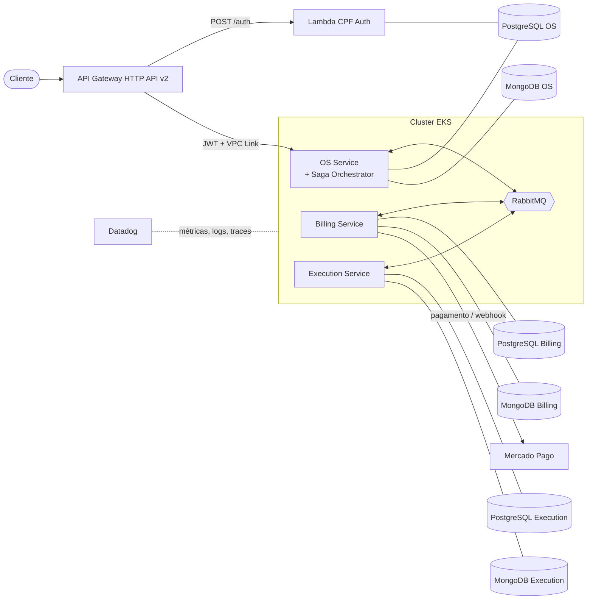
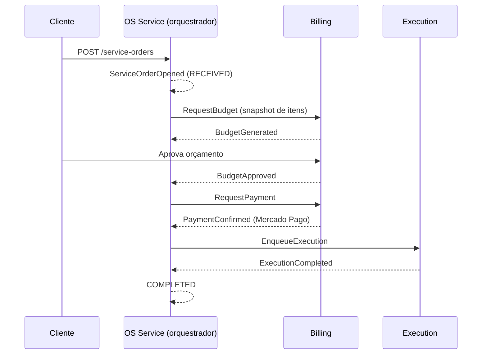
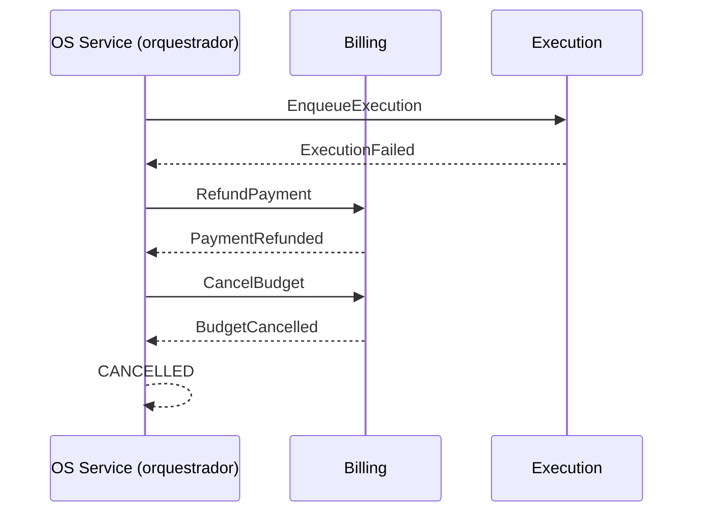

# Arquitetura — Fase 4 (Microsserviços + Saga)

## Visão geral

Nenhum serviço acessa o banco de outro; a comunicação é por mensagens (RabbitMQ) e, quando necessário, REST.

## Saga — fluxo feliz

## Saga — falha na execução (compensação)

## Estados da OS e da Saga

`RECEIVED → IN_DIAGNOSIS → AWAITING_APPROVAL → AWAITING_PAYMENT → IN_EXECUTION → COMPLETED → DELIVERED`, com `CANCELLED` alcançável por rejeição ou compensação. `AWAITING_PAYMENT` é novo na Fase 4.

## Catálogo de eventos e comandos

| Nome | Tipo | Produtor → Consumidor |
|---|---|---|
| `ServiceOrderOpened` | evento | OS → (saga) |
| `RequestBudget` | comando | OS → Billing |
| `BudgetGenerated` / `BudgetFailed` | evento | Billing → OS |
| `BudgetApproved` / `BudgetRejected` | evento | Billing → OS |
| `RequestPayment` | comando | OS → Billing |
| `PaymentConfirmed` / `PaymentFailed` | evento | Billing → OS |
| `EnqueueExecution` | comando | OS → Execution |
| `ExecutionCompleted` / `ExecutionFailed` | evento | Execution → OS |
| `RefundPayment`, `CancelBudget`, `CancelExecution` | comando (compensação) | OS → Billing/Execution |

Todas as mensagens carregam `ServiceOrderId` (correlação), `MessageId` (idempotência) e o *trace context* para rastreamento distribuído no Datadog.

## Decisões relacionadas

ADR-010 (divisão), ADR-011 (saga + mensageria), ADR-012 (bancos), ADR-007 (API Gateway), ADR-009 (HPA).
