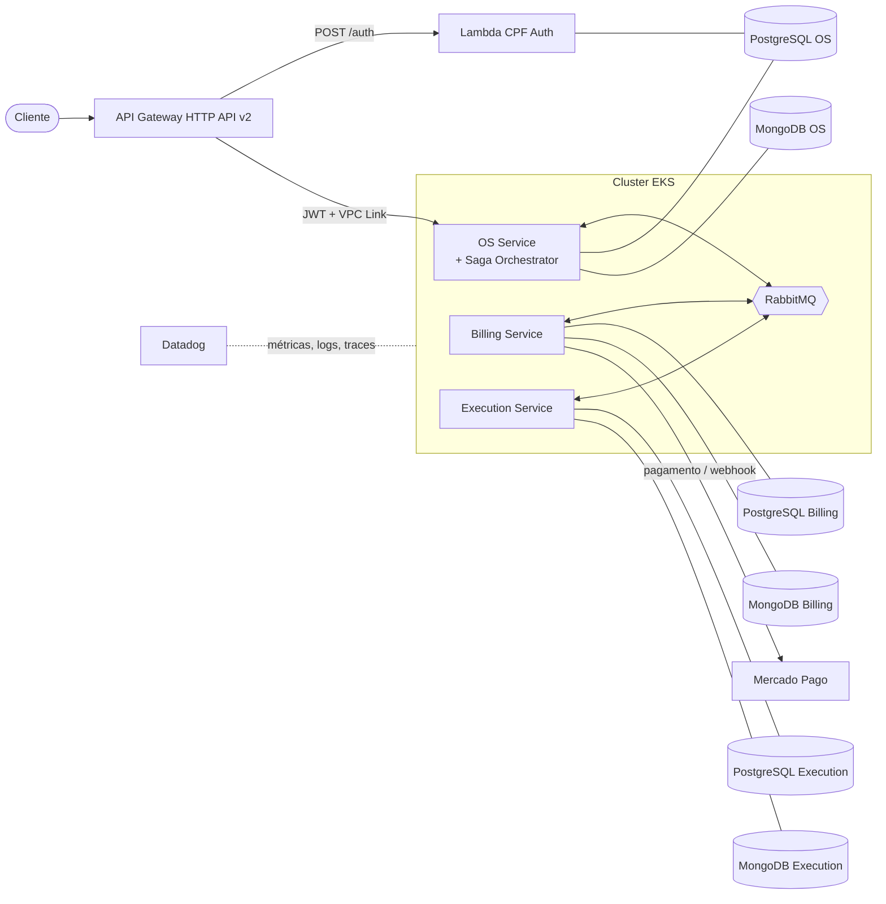

# Tech Challenge — Fase 4
## FIAP POS Tech · 15SOAT · Turma 2026

**Grupo: TorqueOS**

| Nome | RM | Discord |
|---|---|---|
| Allan | RM373714 | @zer07629 |
| Daniel | RM370852 | @danielthx23 |
| Diogo | RM371224 | @smilipow |
| Lucas | RM371615 | @lucaspamponet |
| Joelma Renata | RM371593 | @rnataoliveira |

---

## 1. Repositórios

| Repositório | Propósito | Link |
|---|---|---|
| **mechanics-software** | **OS Service** e orquestrador da saga — clientes, veículos, catálogo/estoque e ciclo de vida da OS (ASP.NET Core 8, PostgreSQL 16 + MongoDB) | https://github.com/Torque-OS/mechanics-software |
| **mechanics-billing-service** | **Billing Service** — orçamentos, pagamento com Mercado Pago, cancelamento e estorno (ASP.NET Core 8, PostgreSQL 16 + MongoDB) | https://github.com/Torque-OS/mechanics-billing-service |
| **mechanics-execution-service** | **Execution Service** — fila de execução, diagnóstico e reparo (ASP.NET Core 8, PostgreSQL 16 + MongoDB) | https://github.com/Torque-OS/mechanics-execution-service |
| **mechanics-lambda** | Autenticação serverless — login por CPF e Lambda Authorizer do API Gateway (Node.js 20) | https://github.com/Torque-OS/mechanics-lambda |
| **mechanics-infra-k8s** | Terraform — VPC, EKS, API Gateway, RabbitMQ e Datadog Agent | https://github.com/Torque-OS/mechanics-infra-k8s |
| **mechanics-infra-db** | Terraform — RDS PostgreSQL 16 e um MongoDB Atlas (M0) por serviço | https://github.com/Torque-OS/mechanics-infra-db |

O usuário `soat-architecture` é colaborador dos 6 repositórios.

---

## 2. Vídeo de demonstração (até 15 min)

> **Link do vídeo:** *(pendente — gravação em 26/11/2026)*
> **Roteiro:** [`docs/project/video-script-fase4.md`](./project/video-script-fase4.md)

O vídeo mostra:
- uma OS passando pelos três serviços via RabbitMQ, do orçamento ao pagamento com QR do Mercado Pago e à execução;
- uma falha na execução e a compensação da saga (OS cancelada, peças devolvidas ao estoque, pagamento estornado);
- o deploy automatizado: pipeline de cada serviço com testes, cobertura mínima de 80% e deploy no EKS;
- o monitoramento no Datadog: dashboard da saga, logs com `CorrelationId` e o trace distribuído de uma OS.

---

## 3. Arquitetura

O API Gateway é a única entrada pública. Ele roteia por prefixo: `/api/budgets` e `/api/payments` vão para o Billing,
`/api/executions` para o Execution e o restante para o OS Service. Todas as rotas protegidas passam pelo Lambda
Authorizer, e cada serviço valida o JWT de novo e aplica as regras de papel (staff ou cliente).

Documentação completa:
- [Arquitetura da Fase 4 e diagramas de sequência da saga — fluxo feliz e compensação](./architecture/architecture-fase4.md)
- [ADR-010 — Divisão em microsserviços](./decisions/ADR-010-microservices-split.md)
- [ADR-011 — Saga orquestrada e mensageria (RabbitMQ + MassTransit)](./decisions/ADR-011-saga-orquestrada-e-mensageria.md)
- [ADR-012 — Banco por serviço (PostgreSQL + MongoDB)](./decisions/ADR-012-banco-por-servico.md)
- [ADR-013 — REST síncrono entre serviços](./decisions/ADR-013-rest-sincrono-entre-servicos.md)
- [Justificativa dos bancos de dados](./database/database-justification.md)
- [Autenticação por CPF](./architecture/sequence-cpf-auth.md)

---

## 4. Estratégia de saga: orquestrada

Conforme o **ADR-011**, usamos uma **saga orquestrada**, com o **OS Service** como orquestrador, **RabbitMQ** como
broker e **MassTransit 8** com outbox e inbox transacionais (EF Core).

**Por que orquestrada**
1. **Um único dono do ciclo de vida da OS.** A OS é a máquina de estados do domínio
   (`RECEIVED → IN_DIAGNOSIS → AWAITING_APPROVAL → AWAITING_PAYMENT → IN_EXECUTION → COMPLETED → DELIVERED`, ou
   `CANCELLED`). Decidir tudo no OS Service evita que Billing e Execution dependam um do outro e deixa o fluxo legível
   em um só lugar.
2. **Compensação explícita.** Cada falha tem uma reação definida no orquestrador, em vez de espalhada por eventos
   entre serviços.

**Mensagens**

| Mensagem | Tipo | Produtor → Consumidor |
|---|---|---|
| `RequestBudget` | comando | OS → Billing — inicia a saga em `POST /api/service-orders/{id}/request-budget`, com o snapshot dos itens |
| `BudgetGenerated` / `BudgetFailed` | evento | Billing → OS |
| `BudgetApproved` / `BudgetRejected` | evento | Billing → OS |
| `PaymentConfirmed` / `PaymentFailed` | evento | Billing → OS |
| `EnqueueExecution` | comando | OS → Execution |
| `ExecutionCompleted` / `ExecutionFailed` | evento | Execution → OS |
| `CancelBudget` | comando (compensação) | OS → Billing |
| `BudgetCancelled` | evento | Billing → OS |

**Compensação**
- Orçamento recusado ou inválido (`BudgetRejected` / `BudgetFailed`) → a OS vai para `CANCELLED` e as peças reservadas
  voltam ao estoque.
- Pagamento falhou (`PaymentFailed`) → OS `CANCELLED`, peças devolvidas e `CancelBudget` para o Billing, que cancela
  o QR em aberto.
- Execução falhou (`ExecutionFailed`) → OS `CANCELLED`, peças devolvidas e `CancelBudget` para o Billing, que estorna o
  pagamento no Mercado Pago (chave de idempotência `refund-<paymentId>`, então o estorno nunca é feito duas vezes) e
  responde com `BudgetCancelled`.

**Confiabilidade da mensageria (F4-24)** — igual nos três serviços:
- **Outbox:** comandos e eventos são gravados na mesma transação da mudança de estado e enviados depois do commit.
- **Inbox:** uma mensagem com `MessageId` já consumido é descartada; os handlers também são idempotentes.
- **Retry e DLQ:** 5 novas tentativas com backoff exponencial (cerca de 16 s) para falhas transitórias. Regra de
  negócio violada ou entidade inexistente vai direto para a fila `_error` (DLQ), sem novas tentativas.

**Consulta síncrona (F4-25, ADR-013)** — `GET /api/service-orders/{id}/billing` consulta o Billing por HTTP com
timeout, retry e circuit breaker. Com o Billing fora do ar, a resposta continua `200`, com `billingAvailable: false`.

---

## 5. Divisão dos microsserviços e bancos de dados

Conforme o **ADR-010** e o **ADR-012**, cada serviço tem seu próprio PostgreSQL 16 e seu próprio MongoDB, e nenhum
serviço acessa o banco de outro: a comunicação é por mensagens e, quando necessário, por REST.

| Serviço | Responsabilidade | PostgreSQL (transacional + outbox/inbox) | MongoDB |
|---|---|---|---|
| **OS Service** | Clientes, veículos, catálogo e estoque, ciclo de vida da OS e orquestração da saga | `service_orders`, `customers`, `vehicles`, `parts`, `services`, `stock_movements`, `service_order_status_history`, `outbox_message`, `inbox_state` | Histórico de status da OS (`service_order_status_history`) — migração em revisão no [#342](https://github.com/Torque-OS/mechanics-software/pull/342); até o merge, o histórico fica no PostgreSQL |
| **Billing Service** | Orçamentos, pagamento com QR dinâmico do Mercado Pago, webhook, cancelamento e estorno | `budgets`, `budget_items`, `payments`, `outbox_message`, `inbox_state` | `mercadopago_notifications` (webhooks brutos) e `payment_events` (histórico do pagamento) |
| **Execution Service** | Fila de execução, diagnóstico, reparo e notas técnicas | `execution_orders`, `outbox_message`, `inbox_state` | `execution_queue` (fila ordenada para leitura) e `execution_notes` (notas de diagnóstico e reparo) |

**Por que PostgreSQL + MongoDB:** os dados com regras e transações (OS, orçamento, pagamento, fila) ficam no
PostgreSQL, que também guarda o outbox e o inbox na mesma transação. O MongoDB recebe o que é append-only ou de
leitura: históricos, payloads brutos do Mercado Pago e a projeção da fila.

---

## 6. Qualidade, testes e CI/CD

Cobertura medida em 17/11/2026 na `main` de cada repositório. Todos os pipelines falham abaixo de 80% de linhas.

| Serviço | Testes | Linhas | Branches | Pipeline |
|---|---|---|---|---|
| **OS Service** | 514 unitários + 47 integração (Testcontainers) + 3 BDD | 96,6% | 92,4% | `coverage.yml` + `deploy.yml` |
| **Billing Service** | 269 unitários | 99,1% | 91,5% | `ci.yml` + `deploy.yml` |
| **Execution Service** | 99 unitários | 95,1% | 63,1% | `ci.yml` + `deploy.yml` |

- **BDD:** `tests/MechanicsSoftware.BddTests/Features/ServiceOrderSaga.feature` (Reqnroll/Gherkin), com 3 cenários da
  saga — fluxo feliz, falha no pagamento e falha na execução. Os cenários exercitam os handlers do orquestrador (OS
  Service), não os outros serviços.
- **SonarCloud** em todos os pipelines. Relatórios do OS Service:
  [cobertura](https://rnataoliveira.github.io/mechanics-software/) ·
  [SonarCloud](https://sonarcloud.io/summary/new_code?id=rnataoliveira_mechanics-software).
- **Deploy:** cada serviço tem seu pipeline; depois dos testes, a imagem vai para o GHCR e os manifestos são aplicados
  no EKS.
- **Postman:** [`MechanicsSoftware.postman_collection.json`](../MechanicsSoftware.postman_collection.json) no OS
  Service. As coleções do Billing e do Execution estão em revisão
  ([billing#10](https://github.com/Torque-OS/mechanics-billing-service/pull/10),
  [execution#9](https://github.com/Torque-OS/mechanics-execution-service/pull/9)).

---

## 7. Monitoramento e rastreamento

**Ferramenta:** Datadog

| Item | Detalhes |
|---|---|
| Dashboard da saga (F4-37) | Volume de OS, tempo por etapa, compensações, mensagens consumidas/publicadas, falhas de consumo e DLQs — [documentação](./observability/saga-dashboard.md). Link público: *(pendente)* |
| Tracing distribuído (F4-36) | OpenTelemetry nas requisições HTTP e nas mensagens do MassTransit, exportado para o Datadog Agent. Ativo no OS Service e no Billing; no Execution, em revisão ([execution#8](https://github.com/Torque-OS/mechanics-execution-service/pull/8)) |
| Logs | JSON com `CorrelationId` em todas as requisições; nas mensagens, o `CorrelationId` é o id da OS |
| Métricas | `/metrics` (Prometheus) de cada serviço e métricas por fila do RabbitMQ, coletadas pelo Datadog Agent |

---

## 8. Infraestrutura

| Componente | Tecnologia | Repositório |
|---|---|---|
| Entrada única | AWS API Gateway HTTP API v2 + VPC Link + NLB interno | mechanics-infra-k8s |
| Autenticação | AWS Lambda (Node.js 20) — CPF → JWT e Lambda Authorizer | mechanics-lambda |
| Cluster | AWS EKS, um namespace por serviço, HPA | mechanics-infra-k8s |
| Mensageria | RabbitMQ no EKS, um usuário por serviço no vhost `/torque-os` | mechanics-infra-k8s |
| Bancos | RDS PostgreSQL 16 e MongoDB Atlas M0 por serviço | mechanics-infra-db |
| Observabilidade | Datadog Agent (Helm) | mechanics-infra-k8s |
| IaC | Terraform | mechanics-infra-k8s / mechanics-infra-db |
| CI/CD | GitHub Actions; `main` protegida com PR obrigatório | todos |

---

## Pendências antes da submissão

- [ ] Link do vídeo (seção 2).
- [ ] Link público do dashboard do Datadog (seção 7).
- [ ] Merge do [#342](https://github.com/Torque-OS/mechanics-software/pull/342) (histórico no MongoDB) e atualizar a seção 5.
- [ ] Merge de [billing#10](https://github.com/Torque-OS/mechanics-billing-service/pull/10), [execution#9](https://github.com/Torque-OS/mechanics-execution-service/pull/9) e [execution#8](https://github.com/Torque-OS/mechanics-execution-service/pull/8) e atualizar as seções 6 e 7.
- [ ] Gerar o PDF a partir deste documento e enviar no portal.
